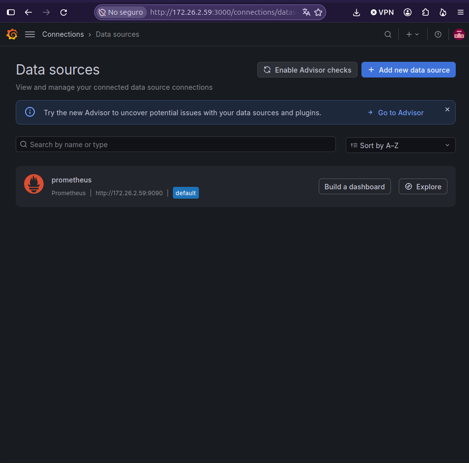

# 1. Introducción a Prometheus y Grafana

**Prometheus** y **Grafana** forman una de las combinaciones más utilizadas para la monitorización de sistemas, servicios y contenedores.

## 1.1 ¿Qué aporta cada herramienta?

| Herramienta | Función principal |
| --- | --- |
| **Prometheus** | Recolecta, almacena y consulta métricas temporales (*time series*) mediante *scraping* HTTP. |
| **Grafana** | Visualiza métricas en paneles (*dashboards*) interactivos y gestiona reglas de alerta. |

