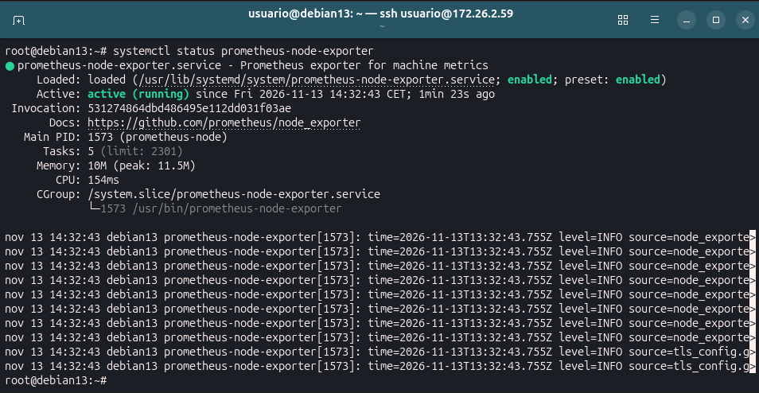
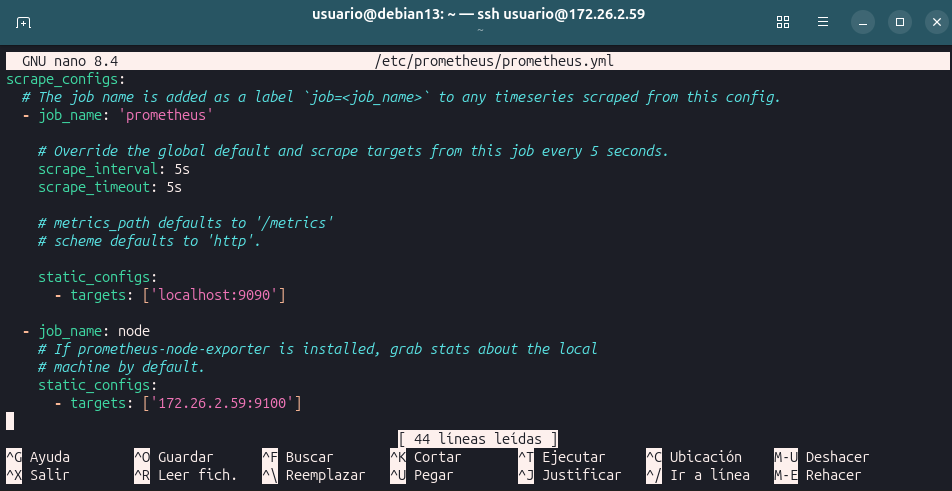
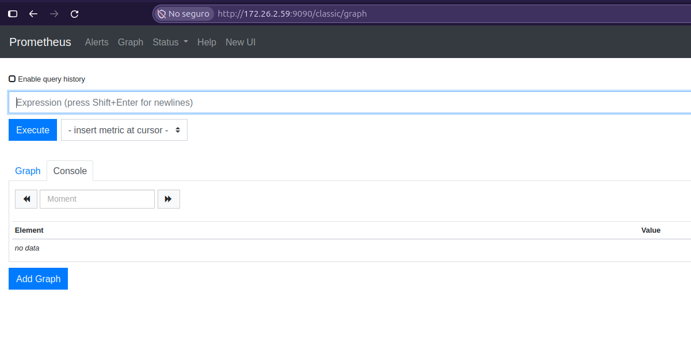
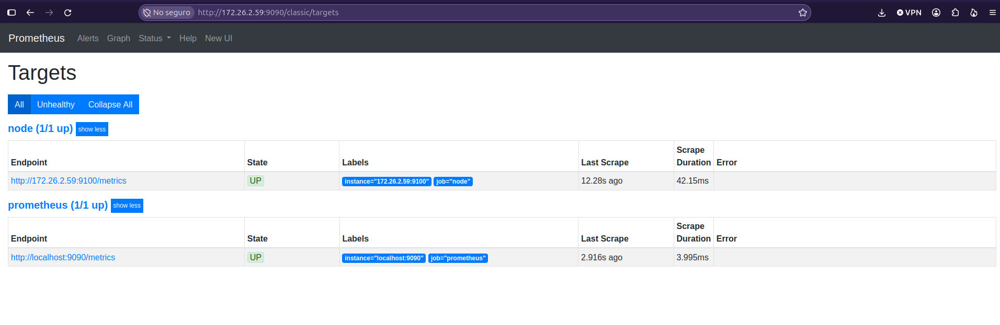

# 2. Instalación de Prometheus

Sección dedicada a la instalación, configuración inicial y puesta en marcha del servidor **Prometheus**.

## 2.1 Instalación y arranque del servicio

Comprueba el estado del servicio tras la instalación:

```bash
sudo systemctl enable --now prometheus
sudo systemctl status prometheus
```

| Puerto / Recurso | Descripción |
| --- | --- |
| `9090` | Interfaz web y endpoint de métricas propio de Prometheus. |
| `/etc/prometheus/prometheus.yml` | Fichero principal de configuración de *scrape*. |



## 2.2 Configuración de `prometheus.yml`

Ejemplo de configuración en [prometheus-1.yml](../ficheros/prometheus-1.yml):

```yaml
global:
  scrape_interval: 15s
  evaluation_interval: 15s

scrape_configs:
  - job_name: "prometheus"
    static_configs:
      - targets:
          - "localhost:9090"

  - job_name: "node_exporter"
    static_configs:
      - targets:
          - "192.168.1.10:9100"
          - "192.168.1.11:9100"
          - "192.168.1.12:9100"
```



## 2.3 Comprobación en la interfaz web

Accede a `http://<IP-servidor>:9090` para verificar la interfaz y el estado de los *targets*:




