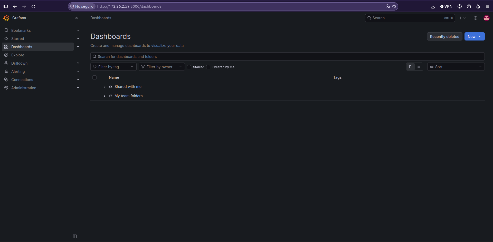

# 3. Instalación de Grafana

Sección dedicada a la instalación y puesta en marcha de **Grafana** para la visualización de métricas.

## 3.1 Arranque y verificación del servicio

```bash
sudo systemctl enable --now grafana-server
sudo systemctl status grafana-server
```

| Dato | Valor predeterminado |
| --- | --- |
| Puerto web | `3000` |
| URL de acceso | `http://<IP-servidor>:3000` |
| Usuario inicial | `admin` |


