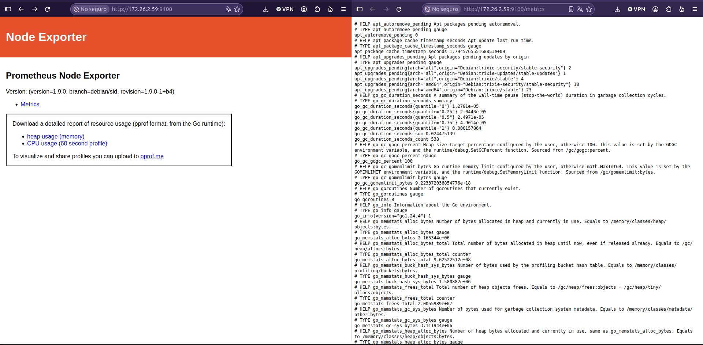

# 5. Monitorización de varios servidores

Para recoger métricas del sistema operativo (CPU, memoria, disco y red) en múltiples nodos se utiliza **Node Exporter** en el puerto `9100`.

## 5.1 Instalación de Node Exporter en los nodos

```bash
sudo systemctl enable --now prometheus-node-exporter
sudo systemctl status prometheus-node-exporter
```



## 5.2 Declaración de múltiples nodos en Prometheus

En [prometheus-2.yml](../ficheros/prometheus-2.yml) se definen los objetivos bajo el trabajo `node_exporter`:

```yaml
  - job_name: "node_exporter"
    static_configs:
      - targets:
          - "192.168.1.10:9100"
          - "192.168.1.11:9100"
          - "192.168.1.12:9100"
```

Tras modificar la configuración, reinicia Prometheus para aplicar los cambios:

```bash
sudo systemctl restart prometheus
```
