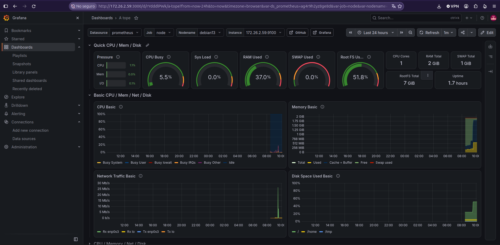

# 7. Consultas personalizadas y paneles

Creación de consultas en **PromQL** y diseño de paneles personalizados en Grafana.

## 7.1 Consultas PromQL habituales

| Métrica / Consulta | Descripción |
| --- | --- |
| `up` | Indica si cada *target* está accesible (`1`) o caído (`0`). |
| `rate(node_cpu_seconds_total{mode!="idle"}[5m])` | Uso medio de CPU en los últimos 5 minutos. |
| `node_memory_MemAvailable_bytes` | Memoria disponible en el nodo. |

